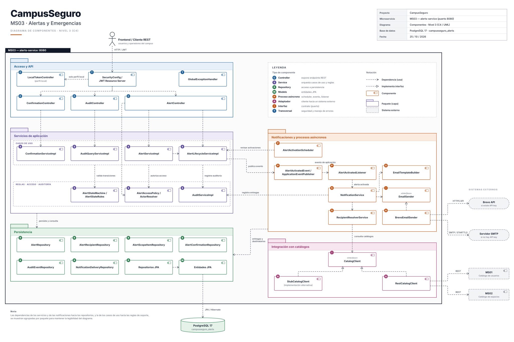

# ms03-alerts-and-emergencies
MS03 - Alerts creation, activation, distribution, and monitoring service.

## 1. Project Overview

MS03 is a microservice responsible for managing alerts and emergencies within the CampusSeguro platform. Its main purpose is to support the creation, activation, distribution, and monitoring of alerts to help communicate relevant information about emergency situations and drills.

The service is organized into modular components to support maintainability, testing, and integration with other services in the platform.

## 1.1 Integration and security

MS03 does not validate JWT. The client authenticates against MS01 and sends the JWT to the API Gateway; the Gateway validates it and injects these headers before forwarding to MS03:

| Header | Required | Content |
|---|---|---|
| `X-User-Id` | Yes | User UUID |
| `X-User-Role` | Yes | One or more official roles separated by commas |
| `X-Service-Name` | No | `ms03` or `ms06` |
| `X-Correlation-ID` | No | UUID v4; MS03 generates one when missing or invalid |

Official roles: `ESTUDIANTE`, `PROFESOR`, `ADMINISTRATIVO`, `BRIGADISTA`, `COORDINADOR`, `ORGANIZADOR`, `ADMIN`, `AUDITOR`. Permissions are `ms03:alert:manage`, `ms03:alert:manage_drill`, `ms03:alert:read_history` and `ms03:alert:receive`; see `docs/api/openapi.yaml`.

Errors always use five fields (`status`, `codigo`, `mensaje`, `errores`, `correlation_id`) and pagination uses `contenido`, `page`, `size`, `total_elementos` and `total_paginas`.

### Endpoints

| Method | Path | Permission |
|---|---|---|
| POST | `/api/v1/alertas` | `manage` or `manage_drill` |
| GET | `/api/v1/alertas` | `read_history` |
| GET | `/api/v1/alertas/{id}` | `receive` or `read_history` |
| PUT | `/api/v1/alertas/{id}` | `manage` |
| PATCH | `/api/v1/alertas/{id}/programar` | `manage` |
| PATCH | `/api/v1/alertas/{id}/activar` | `manage` or `manage_drill` |
| PATCH | `/api/v1/alertas/{id}/finalizar` | `manage` or `manage_drill` |
| PATCH | `/api/v1/alertas/{id}/archivar` | `manage` |
| POST | `/api/v1/alertas/{id}/confirmaciones` | `receive` |
| GET | `/api/v1/alertas/{id}/auditoria` | `read_history` |

## 2. Team Information

### Team Members

| No. | Full Name | 
|---|---|
| 1 | José Daniel García Pineda |
| 2 | Paula Alejandra Novoa Castellanos |
| 3 | Jeronimo Moreno Herrera |
| 4 | Derly Valeria Pachón Pinzón |

### Responsible Squad

- **Squad Name:** Zephyros
- **Project:** CampusSeguro
- **Module:** MS03 - Alerts and Emergencies
- **Repository:** `ms03-alerts-and-emergencies`

## 3. Main Responsibilities

The microservice is intended to support the following responsibilities:

- **Alert Creation:** Manage the creation of alerts associated with emergency situations.
- **Alert Activation:** Support the activation of alerts when an emergency/drill needs to be communicated.
- **Push Distribution:** Support the distribution of alerts through mail notifications.
- **Alert Monitoring:** Provide mechanisms for monitoring alerts and tracking their relevant information.
- **Alert Management:** Organize alert-related information and operations through dedicated application components.

## 4. Technology Stack

- **Programming Language:** Java 21
- **Application Framework:** Spring Boot 4.1.1
- **Build Tool:** Maven
- **Database:** PostgreSQL 17 (Docker Compose)
- **Security:** Spring Security with Gateway-injected identity headers
- **Testing:** JUnit 5, Mockito, MockMvc and Testcontainers
- **API Contract:** OpenAPI 3.1 (`docs/api/openapi.yaml`)
- **Version Control:** Git

## 5. Project Structure

```text
ms03-alerts-and-emergencies/
├── database/
├── docs/
├── src/
│   ├── main/
│   │   ├── java/
│   │   │   └── edu/eci/dosw/campuseguro/alertas/
│   │   │       ├── client/
│   │   │       ├── config/
│   │   │       ├── controller/
│   │   │       ├── dto/
│   │   │       ├── entity/
│   │   │       ├── exception/
│   │   │       ├── mapper/
│   │   │       ├── repository/
│   │   │       ├── scheduler/
│   │   │       ├── security/
│   │   │       ├── service/
│   │   │       ├── validation/
│   │   │       └── AlertsApplication.java
│   │   └── resources/
│   └── test/
│       └── java/
│           └── edu/eci/dosw/campuseguro/alertas/
│               ├── client/
│               ├── controller/
│               ├── exception/
│               ├── mapper/
│               ├── security/
│               ├── service/
│               └── AlertsApplicationTest.java
└── README.md
```


## 6. Installation and Execution

### Prerequisites

Before running the application, ensure that the following tools are installed and configured:

- Java Development Kit (JDK) 21.
- Maven 3.9+.
- Docker Desktop with Docker Compose (PostgreSQL and Testcontainers).
- Git.

### Clone the Repository

```bash
git clone <REPOSITORY_URL>
cd ms03-alerts-and-emergencies
```

Replace `<REPOSITORY_URL>` with the actual repository URL.

### Configure the Application

The `local` profile is active by default and reads `.env` when present. Start PostgreSQL with Docker Compose, then configure the environment variables you need:

```powershell
docker compose up -d postgres
```

Relevant variables: `DB_URL`, `DB_USER`, `DB_PASSWORD`, `MS01_URL`, `MS_SERVICE_KEY`, `MS01_TECHNICAL_USER_ID`, `SPRINGDOC_ENABLED`, `MAIL_*` and `BREVO_*`. Do not commit `.env` or any secret.

Profiles:

- `local`: stub catalog (`catalog-stub.json`), debug logging, Swagger enabled.
- `test`: stub catalog, used by the automated tests.
- `integration`: real MS01 through `MS01_URL`, Swagger disabled, technical user required for recipient resolution.

### Build and Run

**Linux/macOS:**

```bash
mvn clean install
mvn spring-boot:run -Dspring-boot.run.profiles=local
```

**Windows:**

```powershell
mvn clean install
mvn spring-boot:run "-Dspring-boot.run.profiles=local"
```

MS03 listens on `http://localhost:8083`. Through the API Gateway the base URL is `http://localhost:8080`. Swagger UI is available at `/swagger-ui.html` when `SPRINGDOC_ENABLED=true`.

### Integrated Stack (MS01 + API Gateway + MS03)

The integration compose runs the Gateway, MS01, MS03 and both PostgreSQL databases. Only the Gateway publishes a port (`8080`); MS01 and MS03 stay on the internal network:

```powershell
docker compose --env-file .env.gw -f docker-compose.gw.yml up -d --build
```

Create `.env.gw` locally with the variables referenced by `docker-compose.gw.yml`; never commit it. On a fresh `ms01-db` volume, `integration/ms01-seed.sql` creates the technical `AUDITOR` user required for catalog reads. If the volume already exists, apply the seed manually or recreate the volume.

The compose sets `GATEWAY_DOWNSTREAM_TIMEOUT_MS=15000`. The Gateway default of 3 seconds caused `504` responses because MS01 login and recipient resolution can take longer. See `docs/plan-integracion-ms01-api-gateway.md` for the verified E2E flow and external blockers.

## 7. Testing

The test suite covers controllers, services, clients, mappers, exceptions, security and the PostgreSQL integration flow. Docker must be running for Testcontainers.

```powershell
mvn test
mvn clean verify
```

`mvn clean verify` runs unit and integration tests and generates the JaCoCo report at `target/site/jacoco/index.html`. The integration test uses PostgreSQL 17 with Testcontainers.

### Postman Collection

`docs/postman/ms03-alertas.postman_collection.json` runs against the Gateway. The `00 Autenticacion` folder logs in as coordinator, organizer, auditor and student, stores the JWT and real user id in collection variables, and every protected request sends `Authorization: Bearer`. Emails default to local integration users; passwords must come from a local environment or `--env-var` values and must not be committed.

```powershell
postman collection run docs/postman/ms03-alertas.postman_collection.json -e <local-environment.json>
```

The verified run executed 30 requests and 82 assertions with 0 failures. A temporary v3 migration lints with 0 errors and 0 warnings.

## 8. Diagrams

### Database Diagram


### Class Diagram


### Context Diagram


### containers Diagram


### components Diagram



---

**MS03 - Alerts and Emergencies**

*Campus Seguro — Alert Management and Emergency Monitoring Service*