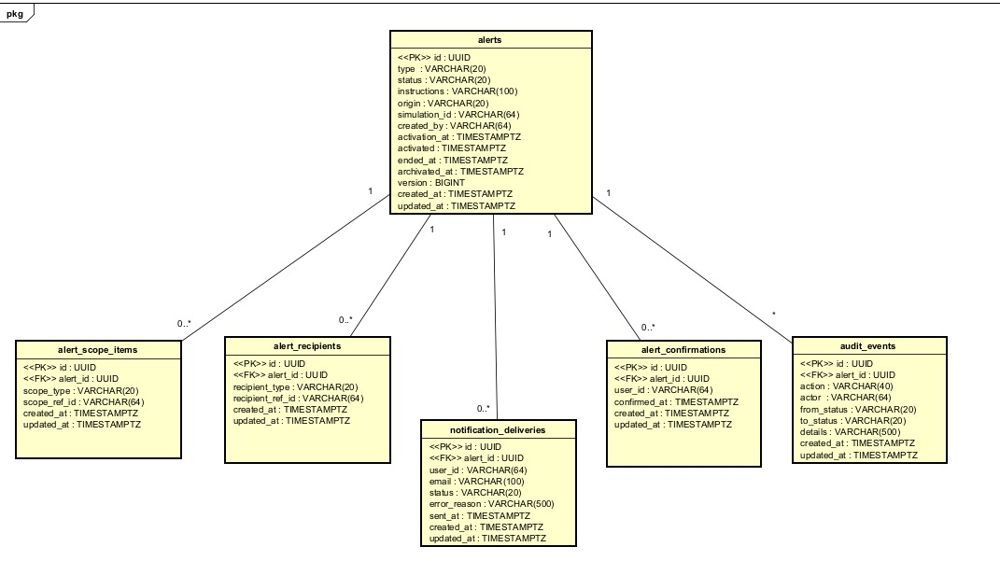
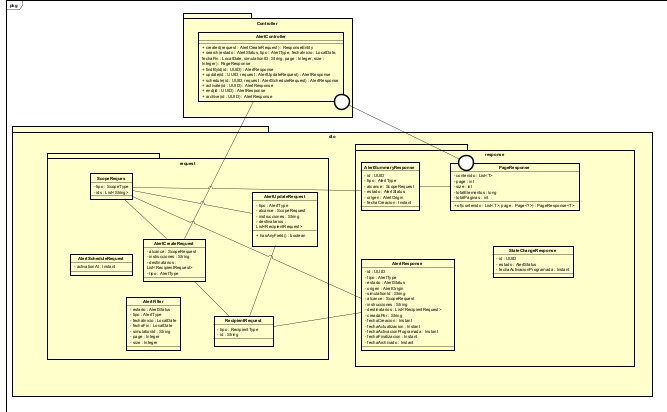
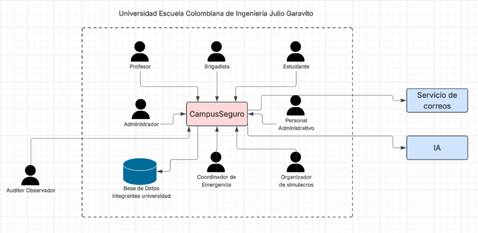
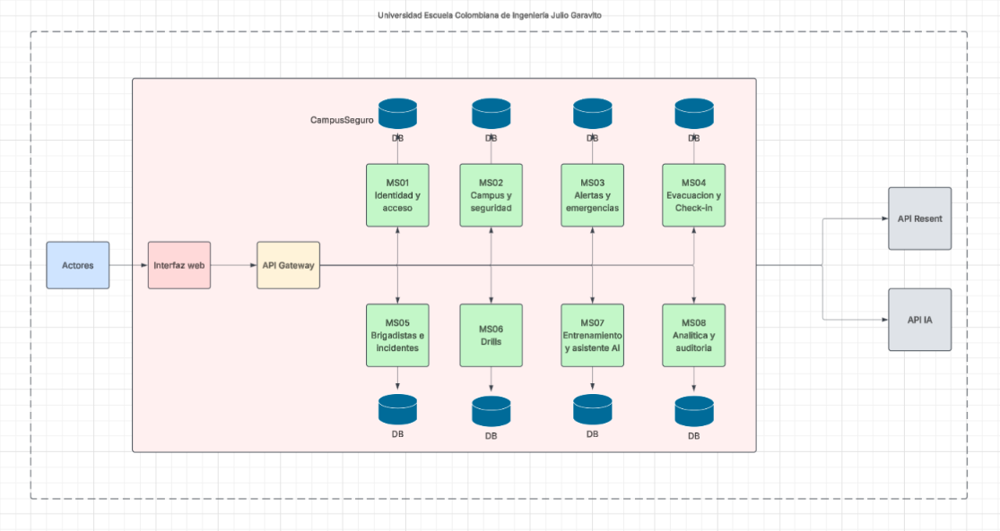
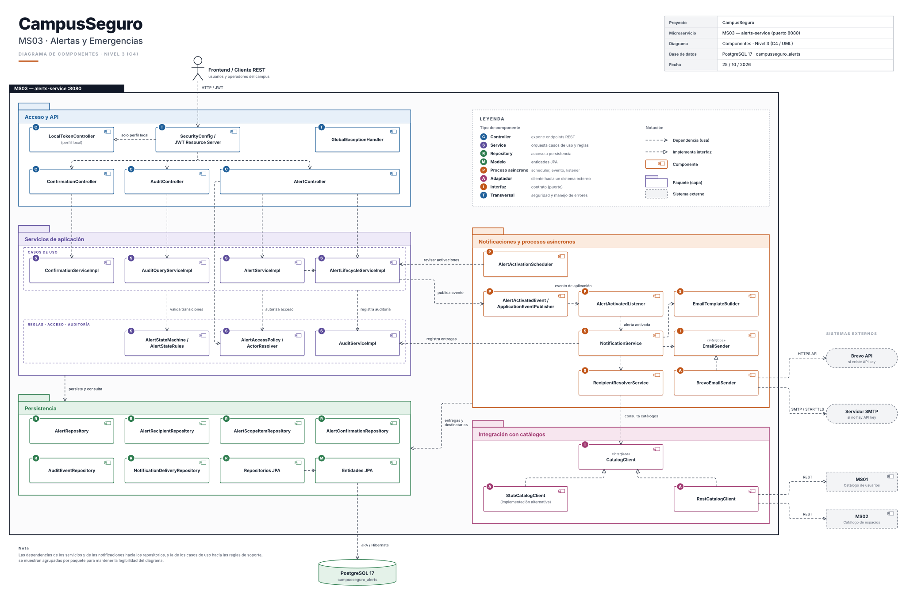

# ms03-alerts-and-emergencies
MS03 - Alerts creation, activation, distribution, and monitoring service.

## 1. Project Overview

MS03 is a microservice responsible for managing alerts and emergencies within the CampusSeguro platform. Its main purpose is to support the creation, activation, distribution, and monitoring of alerts to help communicate relevant information about emergency situations and drills.

The service is organized into modular components to support maintainability, testing, and integration with other services in the platform.

## 1.1 Integration and security

MS03 does not validate JWT. The client authenticates against MS01 and sends the JWT to the API Gateway; the Gateway validates it and injects these headers before forwarding to MS03:

| Header | Required | Content |
|---|---|---|
| `X-User-Id` | Yes | User UUID |
| `X-User-Role` | Yes | One or more official roles separated by commas |
| `X-Service-Name` | No | Optional audit metadata; it does not change the alert origin or permissions |
| `X-Correlation-ID` | No | UUID v4; MS03 generates one when missing or invalid |

Official roles: `ESTUDIANTE`, `PROFESOR`, `ADMINISTRATIVO`, `BRIGADISTA`, `COORDINADOR`, `ORGANIZADOR`, `ADMIN`, `AUDITOR`. Permissions are `ms03:alert:manage`, `ms03:alert:manage_drill`, `ms03:alert:read_history` and `ms03:alert:receive`; see `docs/api/openapi.yaml`.

| Role | Permissions |
|---|---|
| `ESTUDIANTE`, `PROFESOR`, `ADMINISTRATIVO`, `BRIGADISTA` | `receive` |
| `COORDINADOR` | `receive`, `manage`, `read_history` |
| `ORGANIZADOR` | `receive`, `manage_drill`, `read_history` |
| `AUDITOR` | `read_history` |
| `ADMIN` | No MS03 permissions |

`manage` operates manual and simulation alerts. `manage_drill` only operates alerts with `origin=SIMULATION`; a manual alert returns `403 PROHIBIDO`.

Errors always use five fields (`status`, `codigo`, `mensaje`, `errores`, `correlation_id`) and pagination uses `contenido`, `page`, `size`, `total_elementos` and `total_paginas`.

### Alert model

- `types` is an array with one or more values from `EARTHQUAKE`, `FIRE`, `OTHER` and `OPERATIVA`. `SIMULATION` is no longer a type; it is expressed with `origin=SIMULATION`.
- `OPERATIVA` is exclusive: it cannot be combined with another type and cannot be used for a simulation.
- The lifecycle states are `DRAFT`, `SCHEDULED`, `ACTIVE` and `ARCHIVED`. There is no `ENDED` state and there is no `/finalizar` endpoint.
- Valid transitions are `DRAFT -> SCHEDULED/ACTIVE/ARCHIVED`, `SCHEDULED -> ACTIVE/ARCHIVED` and `ACTIVE -> ARCHIVED`.
- Archiving is idempotent: a second archive returns `200`, preserves `archivedAt` and does not duplicate the audit event.
- A simulation is idempotent by `simulationId`: the same live alert with the same data returns `200`; different data returns `409 SIMULACION_DUPLICADA`.

### Endpoints

| Method | Path | Permission |
|---|---|---|
| POST | `/api/v1/alertas` | `manage` or `manage_drill` |
| GET | `/api/v1/alertas` | `read_history` |
| GET | `/api/v1/alertas/mias` | `receive` |
| GET | `/api/v1/alertas/{id}` | `receive` or `read_history` |
| PUT | `/api/v1/alertas/{id}` | `manage` or `manage_drill` |
| PATCH | `/api/v1/alertas/{id}/programar` | `manage` or `manage_drill` |
| PATCH | `/api/v1/alertas/{id}/activar` | `manage` or `manage_drill` |
| PATCH | `/api/v1/alertas/{id}/archivar` | `manage` or `manage_drill` |
| POST | `/api/v1/alertas/{id}/confirmaciones` | `receive` |
| GET | `/api/v1/alertas/{id}/auditoria` | `read_history` |

The list endpoint accepts repeated `type` parameters (`GET /api/v1/alertas?type=FIRE&type=EARTHQUAKE`) with OR semantics and returns each alert once. It also accepts `origin`, `scope` (the scope type), `activeAt` (an ISO instant to find alerts active at that moment), `status`, `startDate`, `endDate`, `simulationId` and pagination.

### Inbox and confirmation

`GET /api/v1/alertas/mias` returns only alerts addressed to the actor as `USER`, by `ROLE`, or through a registered notification delivery. It defaults to `status=ACTIVE`; `ARCHIVED` and `ALL` are also accepted. `DRAFT` and `SCHEDULED` alerts never appear. The response is ordered by `activatedAt` descending and includes `id`, `types`, `title`, `status`, `origin`, `scope`, `instructions`, `activatedAt`, `archivedAt` and `confirmedAt`.

Confirmation is explicit through `POST /api/v1/alertas/{id}/confirmaciones`: the first confirmation returns `201`, a repeat returns `200`, a non-active alert returns `409 ALERTA_NO_ACTIVA`, a non-recipient returns `403 NO_ES_DESTINATARIO` and a missing alert returns `404 ALERTA_NO_ENCONTRADA`. Opening the email link does not confirm the alert.

### Email

Emergency alerts include the base message "Has recibido una alerta oficial de CampusSeguro. Confirma la recepcion y sigue los pasos indicados: {instrucciones}. Ver y confirmar alerta: {link}". `OPERATIVA` alerts omit that base message. The link is `{APP_BASE_URL}/bandeja?alerta={id}`; if `APP_BASE_URL` is empty the link line is omitted. Email is sent only when an alert becomes `ACTIVE`, never on `DRAFT`, `SCHEDULED` or `ARCHIVED`.

## 2. Team Information

### Team Members

| No. | Full Name | 
|---|---|
| 1 | José Daniel García Pineda |
| 2 | Paula Alejandra Novoa Castellanos |
| 3 | Jeronimo Moreno Herrera |
| 4 | Derly Valeria Pachón Pinzón |

### Responsible Squad

- **Squad Name:** Zephyros
- **Project:** CampusSeguro
- **Module:** MS03 - Alerts and Emergencies
- **Repository:** `ms03-alerts-and-emergencies`

## 3. Main Responsibilities

The microservice is intended to support the following responsibilities:

- **Alert Creation:** Manage the creation of alerts associated with emergency situations.
- **Alert Activation:** Support the activation of alerts when an emergency/drill needs to be communicated.
- **Push Distribution:** Support the distribution of alerts through mail notifications.
- **Alert Monitoring:** Provide mechanisms for monitoring alerts and tracking their relevant information.
- **Alert Management:** Organize alert-related information and operations through dedicated application components.

## 4. Technology Stack

- **Programming Language:** Java 21
- **Application Framework:** Spring Boot 4.1.1
- **Build Tool:** Maven
- **Database:** PostgreSQL 17 (Docker Compose)
- **Security:** Spring Security with Gateway-injected identity headers
- **Email:** Brevo (simulated in the `local` profile)
- **Testing:** JUnit 5, Mockito, MockMvc, WireMock, Testcontainers and JaCoCo
- **Static analysis:** SonarQube and SpotBugs
- **API Contract:** OpenAPI 3.1 (`docs/api/openapi.yaml`)
- **Version Control:** Git

## 5. Project Structure

```text
ms03-alerts-and-emergencies/
├── database/
├── docs/
├── src/
│   ├── main/
│   │   ├── java/
│   │   │   └── edu/eci/dosw/campuseguro/alertas/
│   │   │       ├── client/
│   │   │       ├── config/
│   │   │       ├── controller/
│   │   │       ├── dto/
│   │   │       ├── entity/
│   │   │       ├── exception/
│   │   │       ├── mapper/
│   │   │       ├── repository/
│   │   │       ├── scheduler/
│   │   │       ├── security/
│   │   │       ├── service/
│   │   │       ├── validation/
│   │   │       └── AlertsApplication.java
│   │   └── resources/
│   └── test/
│       └── java/
│           └── edu/eci/dosw/campuseguro/alertas/
│               ├── client/
│               ├── controller/
│               ├── exception/
│               ├── mapper/
│               ├── security/
│               ├── service/
│               └── AlertsApplicationTest.java
└── README.md
```


## 6. Installation and Execution

### Prerequisites

Before running the application, ensure that the following tools are installed and configured:

- Java Development Kit (JDK) 21.
- Maven 3.9+.
- Docker Desktop with Docker Compose (PostgreSQL and Testcontainers).
- Git.

### Clone the Repository

```bash
git clone <REPOSITORY_URL>
cd ms03-alerts-and-emergencies
```

Replace `<REPOSITORY_URL>` with the actual repository URL.

### Configure the Application

The `local` profile is active by default and reads `.env` when present. Start PostgreSQL with Docker Compose, then configure the environment variables you need:

```powershell
docker compose up -d postgres
```

Relevant variables: `DB_URL`, `DB_USER`, `DB_PASSWORD`, `MS01_URL`, `MS_SERVICE_KEY`, `MS01_TECHNICAL_USER_ID`, `SPRINGDOC_ENABLED`, `MAIL_*` and `BREVO_*`. Do not commit `.env` or any secret.

Profiles:

- `local`: stub catalog (`catalog-stub.json`), debug logging, Swagger enabled. Email is simulated: each notification is written to the log and recorded as sent. To send real email set `MAIL_PROVIDER=brevo` and `BREVO_API_KEY` in `.env`. On a new Docker volume, `database/006_sample_data.sql` loads one alert in each lifecycle state (`DRAFT`, `SCHEDULED`, `ACTIVE`, `ARCHIVED`); to reload it run `docker compose down -v && docker compose up -d postgres`.
- `test`: stub catalog, used by the automated tests.
- `integration`: real MS01 through `MS01_URL`, Swagger disabled, technical user required for recipient resolution.

### Database migrations

MS03 does not use Flyway or Liquibase. The scripts in `database/` are applied manually, in this order:

1. `001_create_schema.sql`
2. `002_indexes.sql`
3. `003_phase2_contract.sql`
4. `004_align_simulation_contract.sql`
5. `005_business_logic_update.sql`

`spring.jpa.hibernate.ddl-auto=validate` means the service will not start if `005` has not been applied. On a fresh Docker volume, the scripts run automatically in alphabetical order. To upgrade an existing local volume:

1. Schedule a maintenance window and stop every process that writes to the database (MS03, Gateway and any integration job).
2. Back up the database before applying `005`:

   ```powershell
   docker compose exec postgres pg_dump -U campusseguro -d campusseguro_alerts -Fc -f /tmp/ms03_before_005.dump
   docker compose cp postgres:/tmp/ms03_before_005.dump .\ms03_before_005.dump
   ```

3. Apply the migration:

   ```powershell
   Get-Content -Raw .\database\005_business_logic_update.sql |
       docker compose exec -T postgres psql -U campusseguro -d campusseguro_alerts -v ON_ERROR_STOP=1
   ```

4. Verify that `alerts` and `alert_types` counts match, that no `ENDED` value or `ended_at` column remains and that `archived_at` is complete for converted rows.
5. Start the service and run the smoke tests. If the migration fails, restore the backup instead of running a partial rollback.

### Build and Run

**Linux/macOS:**

```bash
mvn clean install
mvn spring-boot:run -Dspring-boot.run.profiles=local
```

**Windows:**

```powershell
mvn clean install
mvn spring-boot:run "-Dspring-boot.run.profiles=local"
```

MS03 listens on `http://localhost:8083`. Through the API Gateway the base URL is `http://localhost:8080`. Swagger UI is available at `/swagger-ui.html` when `SPRINGDOC_ENABLED=true`.

### Integrated Stack (MS01 + API Gateway + MS03)

The integration compose runs the Gateway, MS01, MS03 and both PostgreSQL databases. Only the Gateway publishes a port (`8080`); MS01 and MS03 stay on the internal network:

```powershell
docker compose --env-file .env.gw -f docker-compose.gw.yml up -d --build
```

Create `.env.gw` locally with the variables referenced by `docker-compose.gw.yml`; never commit it. On a fresh `ms01-db` volume, `integration/ms01-seed.sql` creates the technical `AUDITOR` user required for catalog reads. If the volume already exists, apply the seed manually or recreate the volume.

The compose sets `GATEWAY_DOWNSTREAM_TIMEOUT_MS=15000`. The Gateway default of 3 seconds caused `504` responses because MS01 login and recipient resolution can take longer. See `docs/plan-integracion-ms01-api-gateway.md` for the verified E2E flow and external blockers.

## 7. Testing

The test suite covers controllers, services, clients, mappers, exceptions, security and the PostgreSQL integration flow. Docker must be running for Testcontainers.

```powershell
mvn test
mvn clean verify
```

`mvn clean verify` runs unit and integration tests and generates the JaCoCo report at `target/site/jacoco/index.html`. The integration test uses PostgreSQL 17 with Testcontainers and applies `001` through `005`; Docker must be running.

### Continuous Integration

`.github/workflows/ci.yml` runs on every push to `main`/`develop` and on every pull request targeting `main` or `develop`:

- `backend-quality` runs `mvn -B -ntp clean verify` on Java 21: unit tests, the Testcontainers integration tests, the JaCoCo report with its 80 % line-coverage gate, and the SpotBugs analysis. The JaCoCo HTML report and the SpotBugs XML report are uploaded as workflow artifacts.
- `publish-api-image` builds the root `Dockerfile` and publishes `ghcr.io/<owner>/<repo>-api:sha-<commit>` to GHCR. It only runs for pushes to `main`.

SpotBugs runs with `effort=max` and fails the build on medium and high priority findings. Its filters live in `config/spotbugs-exclude.xml`.

### Postman Collection

`docs/postman/ms03-alertas.postman_collection.json` runs against the Gateway. The `00 Autenticacion` folder logs in as coordinator, organizer, auditor and student, stores the JWT and real user id in collection variables, and every protected request sends `Authorization: Bearer`. Emails default to local integration users; passwords must come from a local environment or `--env-var` values and must not be committed.

```powershell
postman collection run docs/postman/ms03-alertas.postman_collection.json -e <local-environment.json>
```

The collection creates multi-type alerts, filters with repeated `type`, exercises scheduling, activation, the inbox, confirmation and archiving, and never calls the removed `/finalizar` endpoint.

### Static Analysis (SonarQube)

The project is analyzed with SonarQube, using the JaCoCo XML report (`target/site/jacoco/jacoco.xml`) as the coverage source.

**Run it locally:**

1. Start SonarQube (http://localhost:9000, first login `admin`/`admin`):

   ```bash
   docker compose --profile sonar up -d sonarqube
   ```

2. In SonarQube, create a local project with key `ms03-alerts-and-emergencies` and generate a token.
3. Build, test and analyze (Docker must be running for the `*IT` tests):

   ```bash
   mvn clean verify sonar:sonar -Dsonar.token=<YOUR_TOKEN>
   ```

   Never commit the token; pass it on the command line or through the `SONAR_TOKEN` environment variable.

**Continuous integration:** `.github/workflows/sonarqube.yml` runs the analysis on every push to `main`/`develop` and on pull requests, and fails when the Quality Gate is not met. Configure the repository:

| Name | Kind | Required | Purpose |
| --- | --- | --- | --- |
| `SONAR_TOKEN` | secret | yes | Token of the project in SonarQube or SonarCloud |
| `SONAR_HOST_URL` | variable or secret | no | Self-hosted server URL; defaults to `https://sonarcloud.io` |
| `SONAR_ORGANIZATION` | variable | on SonarCloud | Organization key that owns the project |
| `SONAR_PROJECT_KEY` | variable | no | Overrides the pom key; SonarCloud projects normally use `<org>_<repo>` |

A self-hosted server must be reachable from GitHub-hosted runners. Without `SONAR_TOKEN` the analysis step is skipped with a warning instead of failing the build.

## 8. Diagrams

### Database Diagram



### Class Diagram



### Context Diagram



### containers Diagram



### components Diagram



---

**MS03 - Alerts and Emergencies**

*Campus Seguro — Alert Management and Emergency Monitoring Service*